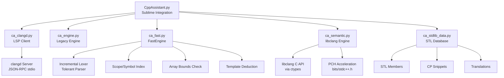

# CppAssistant

[](https://packagecontrol.io/packages/CppAssistant)
[](https://packagecontrol.io/packages/CppAssistant)
[](https://github.com/chenmoulaile/Sublime-CppAssistant/actions)
[](LICENSE)
[](https://www.sublimetext.com/)

> **C++ assistance for Sublime Text 4**, built around a real `clangd` engine with a zero-configuration, zero-dependency fallback. **Designed for OIers (Olympiad in Informatics / 竞赛编程)**.

---

## 🏆 For OIers (竞赛选手专用)

CppAssistant is tailored for competitive programming with features that matter in contest environments:

| Feature | Benefit for OIers |
|---------|-------------------|
| **`bits/stdc++.h` PCH acceleration** | Warm diagnostics in ~200ms, member completion in ~10-20ms |
| **Array bounds checking** | Catches `a[10]` on `int a[10]` instantly |
| **Template parameter deduction** | `vector<int> v; v.` → shows `push_back(int)` not `push_back(value_type)` |
| **CP-specific STL database** | `__int128`, GNU `__gnu_pbds`, fast I/O macros |
| **Diagnostic one-click copy** | `Ctrl+Shift+C` → paste error to group/search |
| **Jiangly-style formatting** | 4-space, K&R, 100-col — matches contest standard |
| **External template packs** | Geometry, Graph, DS, Strings, Math — bundled, install on demand |
| **Snippet tab stops** | `$0`, `$1`, `${1:default}` navigation in templates |
| **Bilingual diagnostics** | Chinese/English/both — understand errors instantly |
| **Menu localization** | `CppAssistant: Toggle Menu Language` — translates CppAssistant's own menu entries |

---

## ✨ Features

### 🎯 Completion
- **clangd semantic completion** — compiler-grade signatures, overloads, container members, local variables
- **FastEngine fallback** — zero-dependency incremental parser for same-file symbols when clangd is unavailable
- **libclang semantic engine** — optional, PCH-accelerated, warm-cache completion
- **Template parameter deduction** — `vector<int> v; v.push_back(` → shows `push_back(int)`
- **`auto` type inference** — `auto it = v.find(x)` → `vector<int>::iterator`; `auto v = m.at("k")` → `int`
- **Complexity hints** — `push_back(int) · O(1)`, `find(const long long&) · O(log n)`, `insert(...) · O(1) avg`
- **Origin labels** — user snippets and packs show `kmp · Strings template`; locals show `int · local variable`
- **Smart `#include` insertion** — respects `bits/stdc++.h`, skips existing headers
- **PBDS header insertion** — `__gnu_pbds::tree` inserts `ext/pb_ds/assoc_container.hpp` + `tree_policy.hpp`, because the universal header does not cover PBDS
- **`__gnu_pbds::` namespace** — `tree`, `gp_hash_table`, `rb_tree_tag`, `tree_order_statistics_node_update` with full template skeletons
- **C++20 subset** — `ranges::sort`, `views::filter`, `integral<T>` and friends, tagged `C++20` so they rank after the C++14 database
- **User snippets + bundled template packs** — install Geometry, Graph, DS, etc. on demand
- **Snippet tab stops** — `$0`, `$1`, `${1:default}` navigation
- **Template browser** — preview the first 20 lines of any installed snippet before inserting

### 🔍 Diagnostics
- **Instant basic check** — brackets, full-width punctuation, unclosed strings/comments (< 10ms)
- **Compiler check** — `g++/clang++ -fsyntax-only` with PCH caching
- **clangd check** — LSP-style live diagnostics, no compiler process
- **libclang check** — PCH-accelerated, precise cross-file locations
- **Array bounds checking** — `int a[10]; a[10]=1` → error
- **One-key full-width fix** — `Ctrl+Alt+,` rewrites `，；：（）` to `,;:()` in code only; comments, strings and raw strings keep their Chinese punctuation
- **Diagnostic one-click copy** — `Ctrl+Shift+C` copies `[file:line:col] severity: message (zh)`
- **Diagnostic filtering** — suppress `-Wunused-variable`, `-Wunused-parameter`, etc.
- **Unused warnings suppressed by default** — CSP-S/NOIP style

### 🧭 Navigation
- **F12 Go to Definition** — scope-aware same-file, cross-file, stdlib fallback
- **Find References** — across project headers, grouped and numbered per file
- **Call / Type Hierarchy** — who calls this function, what it calls, and the class inheritance chain (clangd)
- **Semantic Rename** — clangd-powered project-wide rename
- **Status bar hints** — completion source plus the current call signature and argument index

### ⚡ Code Actions & Formatting
- **Code Actions** — quick fixes, `#include` suggestions, extract function
- **Jiangly-style formatting** — clang-format (4-space, K&R, 100-col) or built-in fallback
- **Format Selection** — clangd `rangeFormatting` or clang-format `--lines`

### 🌐 Localization
- **English / Chinese / Bilingual** — diagnostics and completion details
- **Menu localization** — `CppAssistant: Toggle Menu Language` or switching diagnostics to Chinese; translates CppAssistant's own menu entries only
- **Manual toggle** — `CppAssistant: Toggle Menu Language`

---

## 🏗 Architecture



---

## 📋 Requirements

- **Sublime Text 4** (build 4000+)
- **Optional**: [clangd](https://clangd.llvm.org/) — semantic completion, hover, signature help, LSP diagnostics
- **Optional**: `g++` / `clang++` on `PATH` (or `compiler_path`) — compiler diagnostics, PCH
- **Optional**: `libclang` (`libclang.dll` / `.so` / `.dylib`) — libclang diagnostics, semantic completion, F12
- **Optional**: `clang-format` — formatting

> Python 3.3+ compatible (ST4 uses 3.14). Works on Windows, Linux, macOS.

---

## 📦 Installation

### Package Control (Recommended)
1. `Ctrl+Shift+P` → **Package Control: Install Package**
2. Search **CppAssistant** → Install

### Git Clone
```bash
# Windows
cd "%APPDATA%\Sublime Text\Packages"
git clone https://github.com/chenmoulaile/Sublime-CppAssistant CppAssistant

# Linux/macOS
cd ~/.config/sublime-text/Packages
git clone https://github.com/chenmoulaile/Sublime-CppAssistant CppAssistant
```

### Manual ZIP
Download ZIP → extract to Packages → rename folder to `CppAssistant` → restart Sublime Text.

---

## 🚀 Quick Start

1. Open a `.cpp` / `.h` file
2. Start typing — semantic completions appear
3. **F12** — Go to Definition (add key binding from `Example.sublime-keymap`)
4. `Ctrl+Alt+F` — Format Document (jiangly style)
5. `Ctrl+.` — Code Actions
6. `Ctrl+Shift+C` — Copy Diagnostic

No default key bindings (to avoid conflicts). Copy desired entries from `Example.sublime-keymap` to your user keymap.

---

## ⌨️ Commands

| Command | Purpose |
|---------|---------|
| `CppAssistant: Format Document (jiangly style)` | Format whole file |
| `CppAssistant: Format Selection` | Format selected lines only |
| `CppAssistant: Go to Definition` | Jump to definition (F12) |
| `CppAssistant: Code Actions` | Show quick fixes & refactors |
| `CppAssistant: Rename Symbol` | Rename across project |
| `CppAssistant: Find References` | List references to symbol (grouped by file) |
| `CppAssistant: Call Hierarchy` | Incoming / outgoing calls of the function under the cursor |
| `CppAssistant: Type Hierarchy` | Base classes and derived classes of the type under the cursor |
| `CppAssistant: Show Diagnostics` | Show diagnostics panel |
| `CppAssistant: Copy Diagnostic` | Copy current diagnostic to clipboard |
| `CppAssistant: Install Template Pack` | Install Geometry, Graph, DS, etc. |
| `CppAssistant: Manage Templates` | Enable/disable template packs |
| `CppAssistant: Create User Snippet` | Create snippet from selection |
| `CppAssistant: Edit User Snippets` | Open user snippets folder |
| `CppAssistant: Import Snippets` | Import from JSON file |
| `CppAssistant: Browse Templates` | Preview snippets (first 20 lines) and insert one |
| `CppAssistant: Manage User Snippets` | Open / rename / recycle snippet files |
| `CppAssistant: Fix Full-width Punctuation` | Rewrite `，；：（）` to half-width in code only |
| `CppAssistant: Validate Settings` | Report values Sublime would silently ignore |
| `CppAssistant: Toggle Menu Language` | Switch menu EN ↔ ZH |
| `CppAssistant: Completion Engine Status` | Show clangd/FastEngine status |
| `Preferences: CppAssistant Settings` | Edit settings |

---

## ⚙️ Settings

Open via **Preferences: CppAssistant Settings** or edit `Packages/User/CppAssistant.sublime-settings`.

| Setting | Default | Description |
|---------|---------|-------------|
| `enable_completions` | `true` | Master switch |
| `enable_clangd_engine` | `true` | Use clangd; `false` = built-in DB |
| `enable_fast_engine` | `true` | FastEngine for same-file symbols |
| `enable_libclang_engine` | `true` | Auto-discover libclang |
| `libclang_path` | `""` | libclang path; empty = auto-discover |
| `libclang_pch` | `true` | Build `bits/stdc++.h` PCH |
| `libclang_completion` | `true` | Merge libclang completion when warm |
| `libclang_goto` | `true` | Use libclang for cross-file F12 |
| `clangd_binary` | `""` | clangd executable; empty = PATH |
| `clangd_completion_wait_ms` | `0` | Sync wait for clangd; `0` = never block |
| `enable_clangd_style_completion` | `true` | `true` = fuzzy LSP style; `false` = strict prefix |
| `auto_insert_includes` | `true` | Insert `#include` on completion accept |
| `cpp_auto_insert_pbds_includes` | `true` | Insert `ext/pb_ds/*` for PBDS completions (universal header does not cover them) |
| `show_status_hint` | `true` | Status bar: completion source + call signature + argument index |
| `enable_hover` | `true` | Show clangd hover |
| `enable_signature_help` | `true` | Show signature help in call parens |
| `enable_linting` | `true` | Master switch for diagnostics |
| `lint_engine` | `"compiler"` | `compiler`, `clangd`, or `libclang` |
| `instant_basic_check` | `true` | Millisecond bracket/punctuation checks |
| `lint_debounce` | `0.1` | Seconds idle before compiler check |
| `lint_timeout` | `12` | Compiler timeout (seconds) |
| `enable_pch` | `true` | Build `bits/stdc++.h` PCH cache |
| `show_phantoms` | `true` | Show inline diagnostic phantoms |
| `display_language` | `"en"` | `en`, `zh`, `both` |
| `menu_language` | `"en"` | `en` or `zh`; auto-synced when you switch diagnostic language; only CppAssistant's own menu entries are translated |
| `cxx_standard` | `"c++14"` | Standard for checks and clangd |
| `compiler_path` | `""` | Compiler executable; empty = PATH |
| `compiler_extra_args` | `[]` | Extra compiler args |
| `include_paths` | `[]` | Extra header dirs |
| `suppress_unused_warnings` | `true` | Add `-Wno-unused-variable` etc. by default |
| `diagnostic_filters` | `[]` | Warning codes to suppress (e.g. `["-Wunused-parameter"]`) |
| `indent_width` | `4` | Indent width for built-in formatter |
| `format_on_save` | `false` | Format before save |
| `clang_format_path` | `""` | clang-format executable |
| `clang_format_style` | jiangly config | clang-format style string |

---

## 🔧 How It Works

### Completion Pipeline
1. **clangd** (primary) — async JSON-RPC, `compile_commands.json` cache, fallbackFlags
2. **FastEngine** (fallback) — incremental lexer/parser, scope-aware symbols, template deduction, array bounds
3. **libclang** (optional) — warm-cache semantic completion, PCH acceleration
4. **Built-in STL DB** — common functions, containers, CP-specific types (`__int128`, `tree`, `gp_hash_table`)
5. **User snippets + external template packs** — install on demand, tab-stop navigation

### Diagnostics
| Engine | Speed | Features |
|--------|-------|----------|
| Instant basic check | < 10ms | Brackets, punctuation, strings, `#include`, `#if` |
| Compiler (`g++/clang++`) | ~300ms (PCH) | Full syntax, `-Wall`, PCH cache |
| clangd (LSP) | ~50ms | Live, no compiler process, translated |
| libclang (PCH) | ~200ms | Precise cross-file, no compiler, warm completion |

### F12 Go to Definition
1. FastEngine same-file (scope-aware ranking)
2. Other open files
3. Included headers / `include_paths`
4. libclang cross-file (when warm)
5. Standard library fallback

---

## 🧪 Development

```bash
# Run tests (Python 3.3+)
python -m unittest discover -s tests -v

# libclang tests (opt-in, needs libclang)
CA_TEST_LIBCLANG_PCH=1 python -m unittest tests.test_semantic_engine -v
```

**Main modules:**
- `CppAssistant.py` — Sublime integration, commands, diagnostics, formatting, code actions
- `ca_fast.py` — FastEngine: incremental lexer, tolerant parser, symbol index
- `ca_clangd.py` — Minimal LSP client for clangd
- `ca_semantic.py` — Optional libclang ctypes engine, PCH acceleration
- `ca_engine.py` — Legacy engine, formatting fallbacks, compiler output parsing
- `ca_stdlib_data.py` — STL completion data, CP snippets, translations
- `ca_user_snippets.py` — User `.sublime-snippet` loader

---

## 🐛 Troubleshooting

| Issue | Solution |
|-------|----------|
| **clangd not found** | Install clangd (`pacman -S mingw-w64-x86_64-clang` / `apt install clangd` / `brew install llvm`), or set `clangd_binary` |
| **F12 does nothing** | No default key binding. Use Command Palette or copy F12 from `Example.sublime-keymap` |
| **Enter inserts newline instead of accepting** | Sublime default. Add to user keymap: `{ "keys": ["enter"], "command": "insert", "args": {"characters": "\n"}, "context": [{ "key": "auto_complete_visible" }] }` |
| **Formatting no-op** | Install clang-format or set `clang_format_path` |
| **Code actions/rename/refs no-op** | Require clangd. Save file first. Check **Completion Engine Status** |
| **Diagnostics stopped** | Restart Sublime Text. Check console for `[CppAssistant]` messages |
| **libclang not found** | Install LLVM / MSYS2 / Xcode. Set `libclang_path`. Falls back to compiler engine |
| **libclang PCH unused** | Need `clang++` matching libclang version on PATH |

---

## 📄 License

[MIT](LICENSE) © chenmoulaile

Release history: [CHANGELOG.md](CHANGELOG.md)

---

## 🙏 Acknowledgments

- [clangd](https://clangd.llvm.org/) — the C++ language server
- [jiangly](https://github.com/jiangly) — formatting style reference
- [Sublime Text](https://www.sublimetext.com/) — the editor
- All contributors and OIers who provided feedback