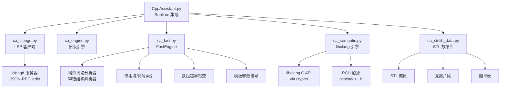

# CppAssistant

[](https://packagecontrol.io/packages/CppAssistant)
[](https://packagecontrol.io/packages/CppAssistant)
[](https://github.com/chenmoulaile/Sublime-CppAssistant/actions)
[](LICENSE)
[](https://www.sublimetext.com/)

> **Sublime Text 4 的 C++ 辅助插件**：内嵌真实 clangd 引擎，没有 clangd 时自动退回零依赖的 FastEngine 结构引擎和纯 Python 内置数据库，零配置可用。**专为 OIers（信息学奥赛/竞赛编程）设计**。

---

## 🏆 面向 OIers（竞赛选手专用）

CppAssistant 为竞赛编程量身定制，提供赛场实用的功能：

| 功能 | 竞赛价值 |
|------|---------|
| **`bits/stdc++.h` PCH 加速** | 热诊断 ~200ms，成员补全 ~10-20ms |
| **数组越界静态检查** | 捕获 `int a[10]; a[10]=1` 等常见 RE |
| **模板参数推导补全** | `vector<int> v; v.` → 显示 `push_back(int)` 而非 `push_back(value_type)` |
| **竞赛专用 STL 数据库** | `__int128`、GNU `__gnu_pbds`、快速 I/O 宏 |
| **诊断一键复制** | `Ctrl+Shift+C` → 粘贴报错到群里/搜方案 |
| **Jiangly 码风格式化** | 4 空格、K&R、100 列 — 符合竞赛标准 |
| **外部模板包** | 几何、图论、数据结构、字符串、数学 — 随包发布，按需安装启用 |
| **Snippet Tab Stop 导航** | 模板中 `$0` `$1` `${1:default}` 跳转 |
| **中英双语诊断** | 编译报错看得懂，不卡英语 |
| **菜单本地化** | `CppAssistant: Toggle Menu Language` — 翻译 CppAssistant 自己的菜单 |

---

## ✨ 核心功能

### 🎯 补全
- **clangd 语义补全** — 编译器级签名、重载、容器成员、局部变量
- **FastEngine 兜底** — 零依赖增量解析器，clangd 不可用时提供同文件符号
- **libclang 语义引擎** — 可选，PCH 加速，热缓存语义补全
- **模板参数推导** — `vector<int> v; v.push_back(` → 显示 `push_back(int)`
- **`auto` 类型推导** — `auto it = v.find(x)` 显示 `vector<int>::iterator`；`auto v = m.at("k")` 显示 `int`
- **复杂度提示** — `push_back(int) · O(1)`、`find(const long long&) · O(log n)`、`insert(...) · O(1) avg`
- **来源标注** — 用户片段/模板包显示 `kmp · 字符串模板`，局部符号显示 `int · 局部变量`
- **智能头文件插入** — 自动补 `#include`，识别 `bits/stdc++.h` 和已包含头文件
- **PBDS 头文件自动插入** — 补全 `__gnu_pbds::tree` 会插入 `ext/pb_ds/assoc_container.hpp` 与 `tree_policy.hpp`（万能头不覆盖 PBDS）
- **`__gnu_pbds::` 命名空间补全** — `tree`、`gp_hash_table`、`rb_tree_tag`、`tree_order_statistics_node_update`，插入时带完整模板骨架
- **C++20 子集** — `ranges::sort`、`views::filter`、`integral<T>` 等，标注 `C++20`，默认排在 C++14 档之后
- **用户片段 + 随包模板包** — 几何、图论、数据结构等按需安装
- **Snippet Tab Stop 导航** — `$0` `$1` `${1:default}` 跳转
- **模板浏览器** — 插入前可预览任意片段的前 20 行

### 🔍 诊断
- **即时基础检查** — 括号、全角标点、未闭合字符串/注释 (< 10ms)
- **编译器检查** — `g++/clang++ -fsyntax-only` 配合 PCH 缓存
- **clangd 检查** — LSP 风格实时诊断，无编译器进程
- **libclang 检查** — PCH 加速，精确跨文件位置
- **数组越界检查** — `int a[10]; a[10]=1` 即时报错
- **全角标点一键修复** — `Ctrl+Alt+,` 把代码区的 `，；：（）` 换成半角；注释、字符串、原始字符串里的中文标点保持原样
- **诊断一键复制** — `Ctrl+Shift+C` 复制 `[文件:行:列] 等级: 信息 (中文)`
- **诊断过滤** — 抑制 `-Wunused-variable`、`-Wunused-parameter` 等
- **默认抑制未使用变量警告** — CSP-S/NOIP 风格

### 🧭 跳转与导航
- **F12 跳转定义** — 同文件作用域感知、跨文件、标准库回退
- **查找引用** — 跨项目头文件，按文件分组并编号
- **调用/类型层级** — 谁调用了当前函数、当前函数调用了谁、类的继承链（clangd）
- **语义重命名** — clangd 驱动的全项目重命名
- **状态栏提示** — 补全来源 + 当前调用签名与第几个实参

### ⚡ 代码操作与格式化
- **代码操作** — 快速修复、添加 `#include`、提取函数等重构
- **Jiangly 码风格式化** — clang-format (4 空格、K&R、100 列) 或内置兜底
- **选区格式化** — clangd `rangeFormatting` 或 clang-format `--lines`

### 🌐 本地化
- **英文 / 中文 / 中英双语** — 诊断与补全详情
- **菜单本地化** — `CppAssistant: Toggle Menu Language` 或切换诊断语言为中文；只翻译 CppAssistant 自己的菜单项
- **手动切换** — `CppAssistant: Toggle Menu Language`

---

## 🏗 架构图



---

## 📋 环境要求

- **Sublime Text 4** (build 4000+)
- **可选**: [clangd](https://clangd.llvm.org/) — 语义补全、悬停、签名提示、LSP 诊断
- **可选**: `g++` / `clang++` 在 `PATH` 中 (或设置 `compiler_path`) — 编译器诊断、PCH
- **可选**: `libclang` (`libclang.dll` / `.so` / `.dylib`) — libclang 诊断、语义补全、F12
- **可选**: `clang-format` — 完整格式化

> Python 3.3+ 兼容 (ST4 使用 3.14)。支持 Windows、Linux、macOS。

---

## 📦 安装

### Package Control（推荐）
1. `Ctrl+Shift+P` → **Package Control: Install Package**
2. 搜索 **CppAssistant** → 安装

### Git Clone
```bash
# Windows
cd "%APPDATA%\Sublime Text\Packages"
git clone https://github.com/chenmoulaile/Sublime-CppAssistant CppAssistant

# Linux/macOS
cd ~/.config/sublime-text/Packages
git clone https://github.com/chenmoulaile/Sublime-CppAssistant CppAssistant
```

### 手动 ZIP 安装
下载 ZIP → 解压到 Packages → 重命名文件夹为 `CppAssistant` → 重启 Sublime Text。

---

## 🚀 快速上手

1. 打开 `.cpp` / `.h` 文件
2. 开始输入 — 语义补全自动出现
3. **F12** — 跳转定义 (从 `Example.sublime-keymap` 复制快捷键)
4. `Ctrl+Alt+F` — 格式化文档 (Jiangly 风格)
5. `Ctrl+.` — 代码操作
6. `Ctrl+Shift+C` — 复制诊断

插件默认不注册快捷键 (避免冲突)。从 `Example.sublime-keymap` 复制需要的条目到用户键位文件。

---

## ⌨️ 命令

| 命令 | 功能 |
|------|------|
| `CppAssistant: Format Document (jiangly style)` | 格式化整个文档 |
| `CppAssistant: Format Selection` | 只格式化选中行 |
| `CppAssistant: Go to Definition` | 跳转定义 (F12) |
| `CppAssistant: Code Actions` | 显示快速修复与重构 |
| `CppAssistant: Rename Symbol` | 跨项目重命名符号 |
| `CppAssistant: Find References` | 列出光标处符号的引用（按文件分组） |
| `CppAssistant: Call Hierarchy` | 查看当前函数的调用方/被调用方 |
| `CppAssistant: Type Hierarchy` | 查看当前类型的基类与派生类 |
| `CppAssistant: Show Diagnostics` | 显示诊断面板 |
| `CppAssistant: Copy Diagnostic` | 复制当前行诊断到剪贴板 |
| `CppAssistant: Install Template Pack` | 安装几何、图论、数据结构等模板包 |
| `CppAssistant: Manage Templates` | 启用/禁用模板包 |
| `CppAssistant: Create User Snippet` | 从选中代码创建片段 |
| `CppAssistant: Edit User Snippets` | 打开用户片段文件夹 |
| `CppAssistant: Import Snippets` | 从 JSON 导入片段 |
| `CppAssistant: Browse Templates` | 预览片段前 20 行并插入 |
| `CppAssistant: Manage User Snippets` | 打开/重命名/回收片段文件 |
| `CppAssistant: Fix Full-width Punctuation` | 只把代码区的全角标点改成半角 |
| `CppAssistant: Validate Settings` | 报告会被 Sublime 静默忽略的设置值 |
| `CppAssistant: Toggle Menu Language` | 菜单中英切换 |
| `CppAssistant: Completion Engine Status` | 查看 clangd/FastEngine 状态 |
| `Preferences: CppAssistant Settings` | 编辑设置 |

---

## ⚙️ 设置

通过 **Preferences: CppAssistant Settings** 打开，或直接编辑 `Packages/User/CppAssistant.sublime-settings`。

| 设置项 | 默认值 | 说明 |
|--------|--------|------|
| `enable_completions` | `true` | 补全总开关 |
| `enable_clangd_engine` | `true` | 使用 clangd；`false` = 内置数据库 |
| `enable_fast_engine` | `true` | FastEngine 提供同文件符号、即时检查、F12 |
| `enable_libclang_engine` | `true` | 自动发现并使用 libclang |
| `libclang_path` | `""` | libclang 路径；空 = 自动发现 |
| `libclang_pch` | `true` | 构建并复用 `bits/stdc++.h` PCH |
| `libclang_completion` | `true` | 翻译单元热缓存时合并 libclang 补全 |
| `libclang_goto` | `true` | 热缓存时用 libclang 跨文件 F12 |
| `clangd_binary` | `""` | clangd 可执行文件；空 = PATH 搜索 |
| `clangd_completion_wait_ms` | `0` | 同步等待 clangd 毫秒数；`0` = 不阻塞 |
| `enable_clangd_style_completion` | `true` | `true` = LSP-clangd 模糊模式；`false` = 严格前缀 |
| `auto_insert_includes` | `true` | 接受补全时自动插入 `#include` |
| `cpp_auto_insert_pbds_includes` | `true` | PBDS 补全后自动插入 `ext/pb_ds/*`（万能头不覆盖 PBDS） |
| `show_status_hint` | `true` | 状态栏显示补全来源 + 调用签名 + 第几个实参 |
| `enable_hover` | `true` | 显示 clangd 悬停文档 |
| `enable_signature_help` | `true` | 函数调用括号内显示签名帮助 |
| `enable_linting` | `true` | 实时诊断总开关 |
| `lint_engine` | `"compiler"` | `compiler`、`clangd` 或 `libclang` |
| `instant_basic_check` | `true` | 毫秒级括号/标点/字符串检查 |
| `lint_debounce` | `0.1` | 输入空闲多少秒后开始编译器检查 |
| `lint_timeout` | `12` | 编译器单次超时 (秒) |
| `enable_pch` | `true` | 构建 `bits/stdc++.h` PCH 缓存 |
| `show_phantoms` | `true` | 显示内联诊断幽灵 |
| `display_language` | `"en"` | `en` / `zh` / `both` |
| `menu_language` | `"en"` | `en` 或 `zh`；切换诊断语言时自动同步；只翻译 CppAssistant 自己的菜单项 |
| `cxx_standard` | `"c++14"` | 检查和 clangd 用的 C++ 标准 |
| `compiler_path` | `""` | 编译器路径；空 = PATH 搜索 |
| `compiler_extra_args` | `[]` | 额外编译参数 |
| `include_paths` | `[]` | 额外头文件目录 |
| `suppress_unused_warnings` | `true` | 默认添加 `-Wno-unused-variable` 等 |
| `diagnostic_filters` | `[]` | 要抑制的警告代码 (如 `["-Wunused-parameter"]`) |
| `indent_width` | `4` | 内置格式化器缩进宽度 |
| `format_on_save` | `false` | 保存前格式化整个文档 |
| `clang_format_path` | `""` | clang-format 路径 |
| `clang_format_style` | jiangly 配置 | clang-format style 字符串 |

---

## 🔧 工作原理

### 补全流水线
1. **clangd** (主) — 异步 JSON-RPC、`compile_commands.json` 缓存、fallbackFlags
2. **FastEngine** (兜底) — 增量词法/解析、作用域符号、模板推导、数组越界
3. **libclang** (可选) — 热缓存语义补全、PCH 加速
4. **内置 STL 数据库** — 常用函数、容器、竞赛类型 (`__int128`、`tree`、`gp_hash_table`)
5. **用户片段 + 外部模板包** — 按需安装、Tab Stop 导航

### 诊断引擎对比
| 引擎 | 速度 | 特性 |
|------|------|------|
| 即时基础检查 | < 10ms | 括号、标点、字符串、#include、#if |
| 编译器 (g++/clang++) | ~300ms (PCH) | 完整语法、-Wall、PCH 缓存 |
| clangd (LSP) | ~50ms | 实时、无编译器进程、已翻译 |
| libclang (PCH) | ~200ms | 精确跨文件、无编译器、热补全 |

### F12 跳转定义
1. FastEngine 同文件 (作用域感知排序)
2. 其他已打开文件
3. 包含的头文件 / `include_paths`
4. libclang 跨文件 (热缓存时)
5. 标准库回退

---

## 🧪 开发与测试

```bash
# 运行测试 (Python 3.3+)
python -m unittest discover -s tests -v

# libclang 测试 (需 libclang)
CA_TEST_LIBCLANG_PCH=1 python -m unittest tests.test_semantic_engine -v
```

**核心模块:**
- `CppAssistant.py` — Sublime 集成、命令、诊断、格式化、代码操作
- `ca_fast.py` — FastEngine: 增量词法、容错解析、符号索引
- `ca_clangd.py` — 精简 clangd LSP 客户端
- `ca_semantic.py` — 可选 libclang ctypes 引擎、PCH 加速
- `ca_engine.py` — 旧版引擎、格式化兜底、编译器输出解析
- `ca_stdlib_data.py` — STL 补全数据、竞赛片段、翻译表
- `ca_user_snippets.py` — 用户 `.sublime-snippet` 加载器

---

## 🐛 常见问题

| 问题 | 解决方案 |
|------|----------|
| **找不到 clangd** | 安装 clangd (`pacman -S mingw-w64-x86_64-clang` / `apt install clangd` / `brew install llvm`)，或设置 `clangd_binary` |
| **F12 没反应** | 默认无快捷键。用命令面板，或从 `Example.sublime-keymap` 复制 F12 |
| **回车接受补全不换行** | Sublime 默认。用户键位加: `{ "keys": ["enter"], "command": "insert", "args": {"characters": "\n"}, "context": [{ "key": "auto_complete_visible" }] }` |
| **格式化无变化** | 安装 clang-format 或设置 `clang_format_path` |
| **代码操作/重命名/引用无反应** | 需 clangd。先保存文件。查看 **Completion Engine Status** 确认 clangd 运行 |
| **诊断突然停止** | 重启 Sublime Text。控制台查看 `[CppAssistant]` 消息 |
| **找不到 libclang** | 安装 LLVM / MSYS2 / Xcode。设置 `libclang_path`。加载失败自动回退编译器引擎 |
| **libclang PCH 未生效** | 需匹配版本的 `clang++` 在 PATH 中。无匹配驱动时仍可诊断，但每次解析头文件 |

---

## 📄 许可证

[MIT](LICENSE) © chenmoulaile

---

## 🙏 致谢

- [clangd](https://clangd.llvm.org/) — C++ 语言服务器
- [jiangly](https://github.com/jiangly) — 格式化风格参考
- [Sublime Text](https://www.sublimetext.com/) — 编辑器本体
- 所有贡献者和提供反馈的 OIers